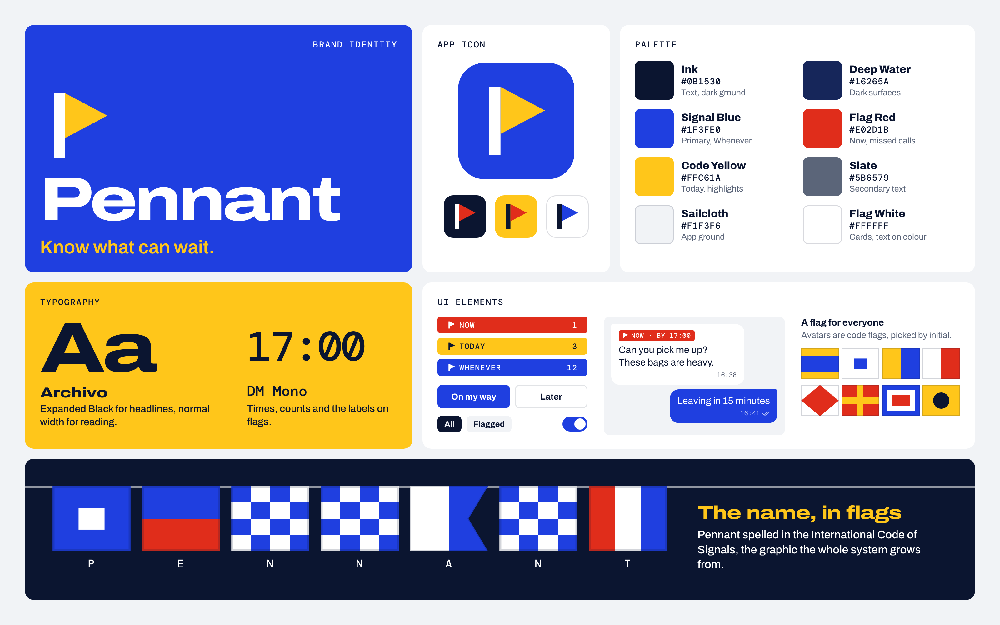
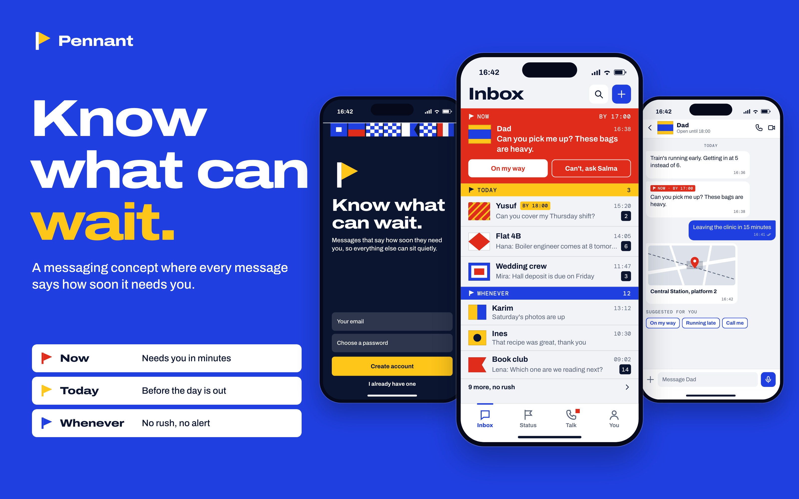
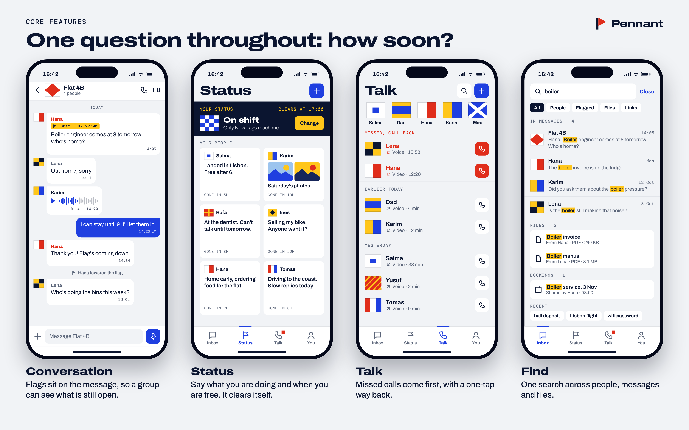
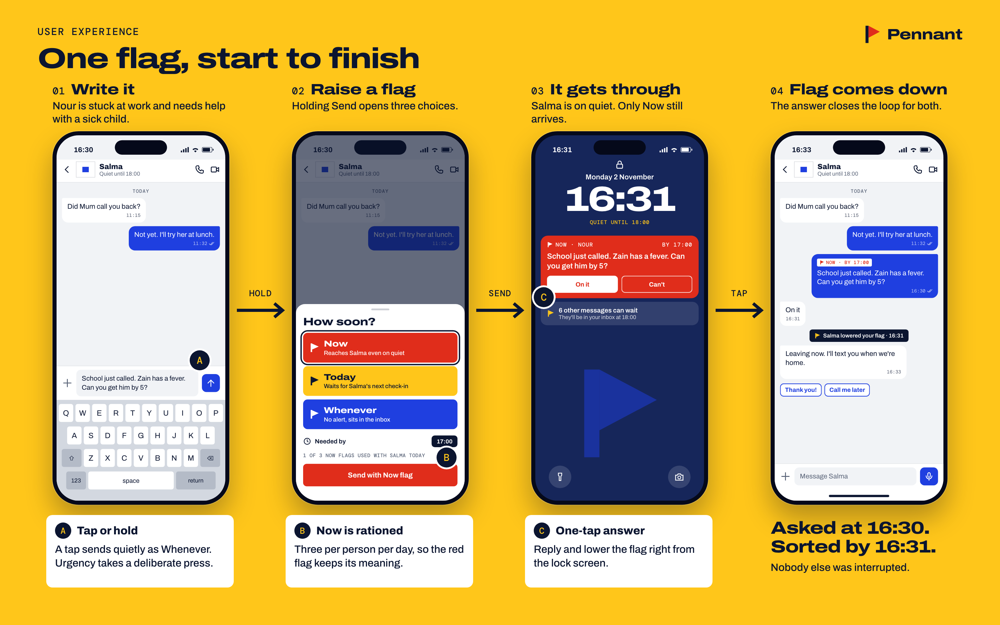
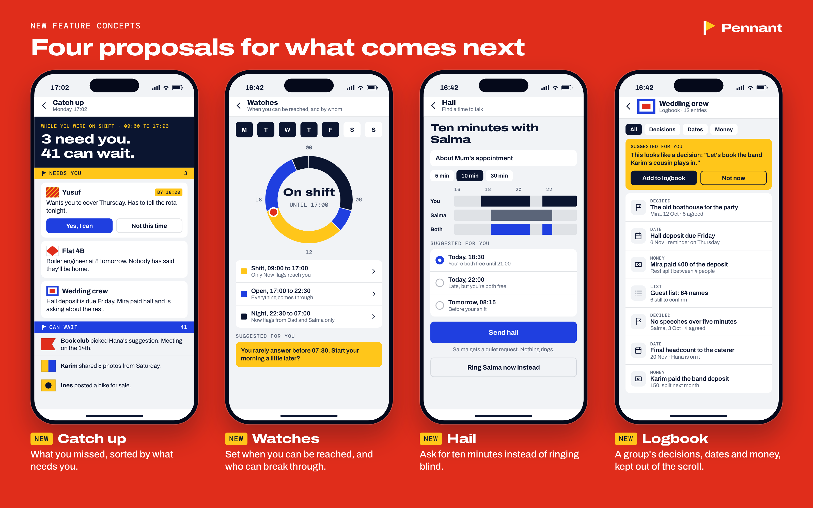
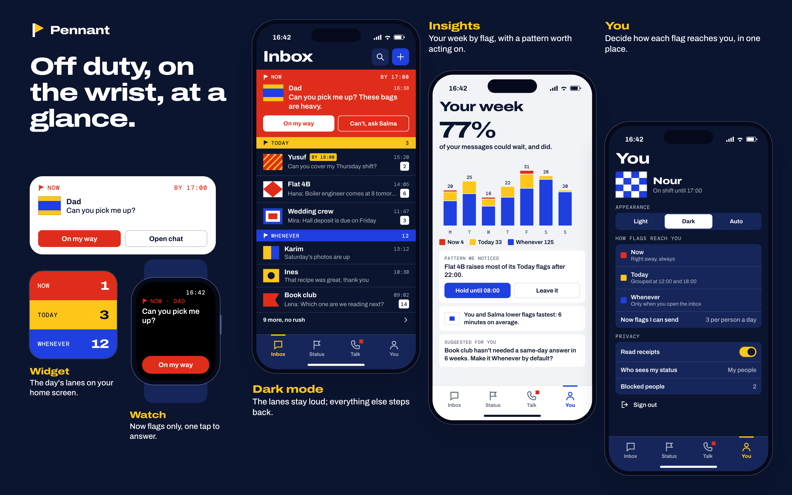

# Pennant

**Know what can wait.**

> **Product concept.** Pennant is not published on the App Store or Google Play, and the screens shown here are not a working product.

## Introduction

Pennant is a messaging app concept built around one small change: whoever sends a message also says how soon it needs an answer. There are three choices, Now, Today and Whenever, and the inbox sorts itself by them instead of by whatever arrived last.

It is a redesign concept based on an earlier messaging prototype. The domain stayed. The name, the identity, the structure and every screen were started again from nothing.

## What it does

- **Flags every message.** Now needs you in minutes, Today before the day is out, and Whenever carries no alert at all.
- **Sorts the inbox into lanes.** Whoever needs you right now sits at the top in a red block, with answers one tap away.
- **Respects quiet time.** When someone has gone quiet, only a Now flag gets through. Everything else waits in its lane.
- **Closes the loop.** Answering lowers the flag, so the sender knows it is handled and nobody has to chase.

## The problem

Messaging apps treat every message the same. A school calling about a sick child and a group debating a restaurant arrive with the same sound, the same badge and the same place in the list.

So people adapt. They mute the noisy groups and miss the one message that mattered, or they check their phone all day just in case. The sender usually knows exactly how urgent a message is. The app never asks.

## Who it's for

- **People who can't look at their phone for hours:** nurses, teachers, drivers, anyone on shift. They come back to a short list instead of a long scroll.
- **Families and households** sorting out pickups, appointments and repairs.
- **Small groups with something to organise:** a shared flat, a wedding, a volunteer team.

It is not aimed at large public communities or broadcast channels, where urgency between two people has little meaning.

## Main features (redesigned)

The earlier prototype covered sign-in, conversations, status posts, a call list, search and a dark theme. All of them were redesigned here, with the flag system running through each one. The flags and lanes themselves are new to this concept.

- **Inbox.** Three lanes, with the most urgent message at the top and answers ready to tap.
- **Conversation.** Flags sit on the message, so a group can see what is still open and who closed it. Voice notes, locations and suggested replies live in the same thread.
- **Status.** Say what you are doing and when you are free. Posts clear themselves, so nobody reads yesterday's news.
- **Talk.** Voice and video calls, with missed ones first and a one-tap way back.
- **Find.** One search across people, messages and files.
- **You.** A single tab replaces the hidden side menu: appearance, privacy and how each flag reaches you.

### One flag, start to finish

Nour is stuck at work when the school calls. Holding Send opens the three flags, and the message goes out as Now, needed by 17:00. Salma's phone is on quiet, but Now gets through, and one tap on the lock screen answers it and lowers the flag. Nobody else is interrupted.

Two decisions carry the idea:

- **A plain tap sends as Whenever.** Urgency takes a deliberate press.
- **Now is rationed to three per person per day.** If everything can be urgent, the red flag stops meaning anything.

## New proposed features

> **These are proposals.** None of them is implemented. They show where the product could go next.

- **Catch up.** Back from a shift, you see what needs you and what can wait, instead of 44 unread messages.
- **Watches.** Set when you can be reached and who can break through, on a 24-hour ring.
- **Hail.** Ask for ten minutes and pick a time you are both free. Nothing rings.
- **Logbook.** A group's decisions, dates and money, kept out of the scroll. When something looks like a decision, Pennant suggests saving it.

Three more proposals sit around the core app, shown here next to the redesigned dark theme:

- **Insights.** Your week by flag, with a "Pattern we noticed" card and a suggested fix.
- **Watch.** Now flags only, with one tap to answer.
- **Widget.** The day's lanes on your home screen.

## From prototype to product

| Stage | What happens | What has to be true to move on |
| --- | --- | --- |
| Clickable prototype | People walk through the flag journey using real situations from their week | They choose the same flag for the same message |
| Group trial | A few households and flats use flags for two weeks | Now stays rare and nobody feels nagged |
| Trust and safety review | Blocking, reporting, privacy and the limit on Now are tested against misuse | A Now flag can't be used to harass someone |
| Accessibility review | Flags are checked for colour blindness, contrast and screen readers | Colour is never the only signal |
| Private beta | Inbox, Conversation, Status and Talk go to small invited groups | People are still using flags after the first month |

## The concept and its value

The sender spends one second. The receiver gets their attention back. For people, that means less checking and fewer missed messages. For a product, it is a clear reason to switch, because it changes the inbox itself rather than adding another setting.

The identity comes from the same idea. Ships have long used flags to say urgent things across a distance, and the International Code of Signals gives every letter a flag of its own. Pennant takes its colours and shapes from that code: flat, hard-edged, nothing decorative. Red always means Now, yellow always means Today, blue always means Whenever. Everyone's avatar is the code flag of their initial, and the logo is a mast and pennant that also reads as a P.

### Palette

- **Ink** `#0B1530`: text, dark ground
- **Deep Water** `#16265A`: dark surfaces
- **Signal Blue** `#1F3FE0`: primary, Whenever
- **Flag Red** `#E02D1B`: Now, missed calls
- **Code Yellow** `#FFC61A`: Today, highlights
- **Slate** `#5B6579`: secondary text
- **Sailcloth** `#F1F3F6`: app ground
- **Flag White** `#FFFFFF`: cards, text on colour

Headlines are set in Archivo Expanded Black, reading text in Archivo, and times, counts and labels in DM Mono.

---

Product concept by Ziad Abdellah.
